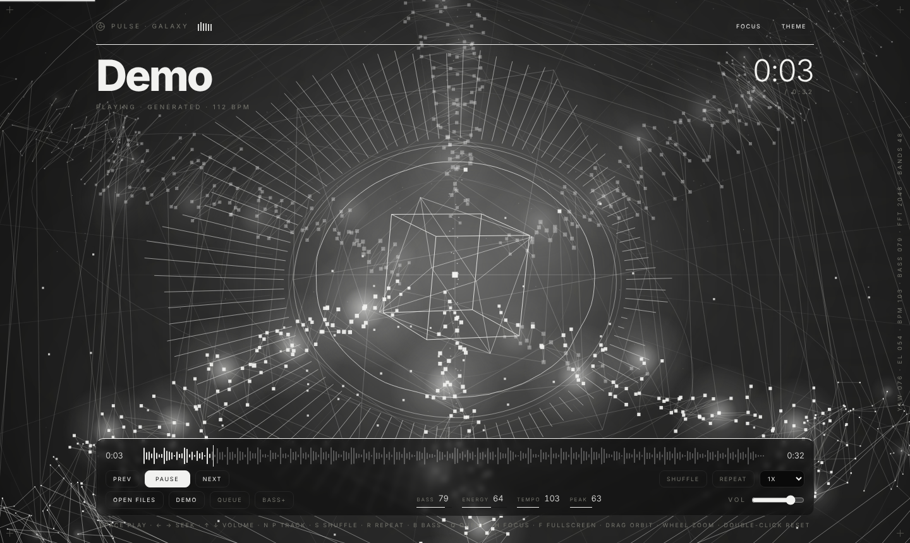
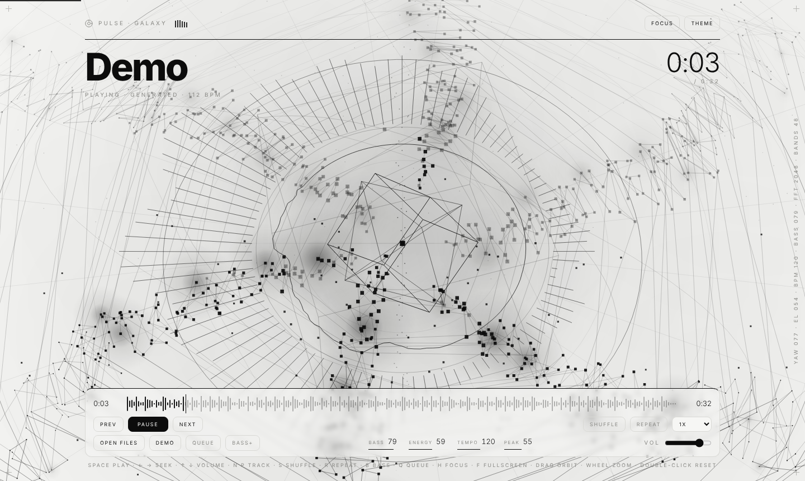
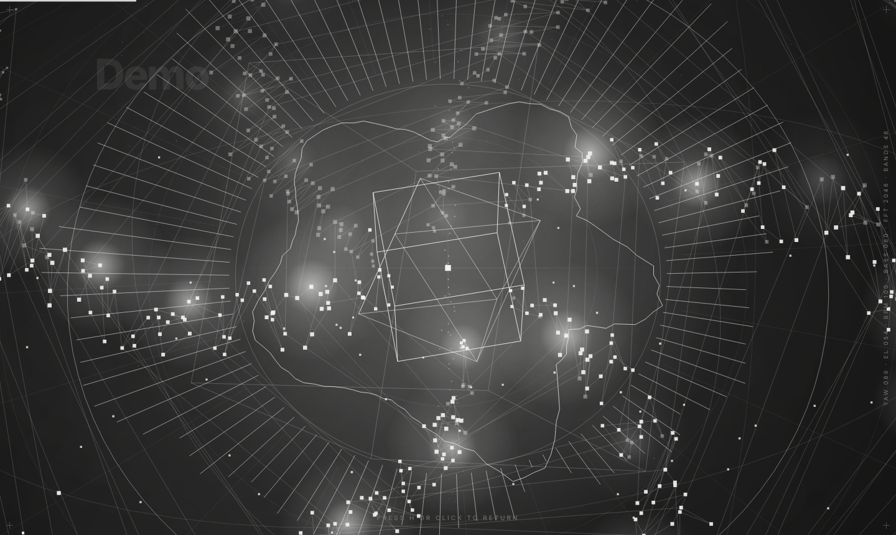
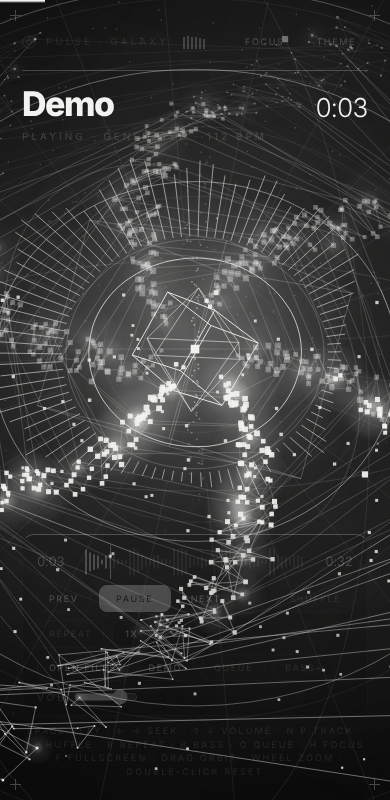

<div align="center">

# Pulse Galaxy

**A music player whose visualizer is an entire galaxy.**
One HTML file. No build step. No dependencies. No WebGL.

[Live demo](#live-demo) · [Features](#features) · [How it works](#how-it-works) · [Controls](#controls)



</div>

---

## What it is

Pulse Galaxy is a local audio player. You drop in files, and the music is turned into a rotating galaxy in real time: every spiral arm, star, ring and particle is driven by the live spectrum of the track you are hearing.

The whole project is a single `index.html` (~57 KB). The 3D scene is a hand-written perspective projection on a plain 2D canvas. It uses no Three.js, no WebGL and no framework.

The interface follows a **minimal, monochrome, editorial** design system: one foreground color against one background, hairline borders, an oversized display title, and no accent color, emoji or decorative shadows.

| Dark | Light |
| :---: | :---: |
|  |  |

| Focus mode | Mobile |
| :---: | :---: |
|  |  |

## Live demo

Open `index.html` in any modern browser and press **Demo**. It renders a 32-second synthesized track offline (kick, snare, hats, bass, lead), so you can try the visuals without any audio file.

To host it on GitHub Pages, push the repository and enable Pages from the `main` branch (root). No build is required.

## Features

### Player
- Open multiple files or drag and drop them anywhere on the page
- Queue with a clickable list, shuffle, repeat (off / all / one), previous with history
- **Waveform seek bar** decoded from the actual file, with drag-to-scrub
- Playback speed from 0.75x to 2x
- **Bass+** low-shelf boost (+7 dB below 140 Hz) that also strengthens the visual response
- MP3 **ID3v2 tags** (title, artist, album) read in the browser
- Media Session integration, so headphone keys and lock-screen controls work
- Screen Wake Lock while playing
- Theme, volume, speed, shuffle, repeat and bass boost persist in `localStorage`

### Visuals
The scene has 11 layers, all monochrome and all derived from the current theme color:

1. **Nebula**: soft drifting glow blobs that brighten with energy
2. **Polar grid**: concentric rings and radial lines in the disc plane
3. **Halo**: a far star field in a spherical shell
4. **Orbit rings**: three tilted rings, each carrying a planet
5. **Spiral arms**: 6 arms x 190 points, where radius maps to frequency and each point is displaced by its own band; cross-arm ribs and bright glowing stars
6. **Dust**: 520 particles with differential rotation that lift with the high frequencies
7. **Spectrum crown**: 96 mirrored radial bars around the core
8. **Shockwaves**: expanding rings fired on every detected beat
9. **Oscilloscope ring**: the live waveform wrapped around the core
10. **Polar jets**: particle streams from both poles, with length driven by bass
11. **Core**: a glowing center with three counter-rotating wireframes (cube, octahedron, outer cube), plus an anamorphic light streak on each beat

### Interaction
- **Drag** to orbit, **scroll** to zoom, **double-click** to reset the camera
- Pointer parallax and a camera nudge on every beat
- **Immersive mode**: the UI fades out after 4.5 s of inactivity while music plays
- **Focus mode** (`H`) hides the interface and enlarges the galaxy
- Fullscreen (`F`)
- Live telemetry strip (camera angle, BPM, bass, FFT size, band count)

## Controls

| Key | Action |
| --- | --- |
| `Space` | Play / pause |
| `←` `→` | Seek 5 seconds |
| `↑` `↓` | Volume |
| `N` / `P` | Next / previous track |
| `S` | Shuffle |
| `R` | Cycle repeat (off, all, one) |
| `B` | Bass boost |
| `M` | Mute |
| `Q` | Queue |
| `H` | Focus mode |
| `F` | Fullscreen |
| `T` | Toggle theme |
| `Esc` | Leave focus mode |
| `Home` / `End` | Start / end of track (with the waveform focused) |

## How it works

### Audio graph

```
<audio> → MediaElementSource ─┬─→ Analyser (FFT 2048)   → spectrum + waveform
                              ├─→ Analyser (FFT 1024)   → beat detection
                              └─→ Low-shelf → Gain → destination
```

The analysers tap the signal **before** the gain node, so lowering the volume never dims the visuals.

### Analysis
- **48 logarithmic bands** from the bass up to 12 kHz, each power-compressed and tilted slightly toward the highs
- **Beat detection** uses positive spectral flux over the low bins of an unsmoothed analyser, compared against an adaptive moving-average threshold, with a 260 ms refractory period
- **Tempo** is the median of recent beat intervals, folded into the 70 to 180 BPM range and smoothed
- On the built-in demo track this settles within a few BPM of the true 112 BPM

### Rendering
- A fixed full-screen `<canvas>` with a hand-written yaw/pitch perspective projection
- Capped at **30 fps** and a device pixel ratio of **1.5**
- No `ctx.filter`, no `shadowBlur` and no per-frame gradients; every glow is one pre-rendered radial sprite drawn with `drawImage`
- Segments are batched into depth buckets to keep the draw-call count low
- **Adaptive quality**: if the frame rate drops, particle counts shrink automatically and recover afterwards
- Glow strength is tuned per theme so the light theme stays clean and the dark theme stays near black
- `prefers-reduced-motion` is respected

### Waveform
Files up to 30 MB are decoded with `OfflineAudioContext`, reduced to 400 peak values and drawn on a small canvas. Larger files still play normally, with an empty waveform.

## Browser support

Any current Chromium-based browser, Firefox or Safari with Web Audio, `OfflineAudioContext` and Canvas 2D. Supported audio formats are whatever your browser can decode (MP3, WAV, OGG, FLAC, M4A, AAC, Opus and others). Media Session, Wake Lock and fullscreen are used when available and ignored otherwise.

## Known limitations

- Inter is loaded from Google Fonts. Offline, the system font is used instead and the layout shifts slightly.
- ID3 tags are only parsed for MP3 files (v2.3 and v2.4, within the first 256 KB).
- On small screens the galaxy sits behind the title and player, and the meters are hidden.
- On low-end hardware, lower `DN` (dust) and `HN` (halo stars) at the top of the scene section.

## Customizing

Everything is in `index.html`.

| What | Where |
| --- | --- |
| Colors and theme | CSS variables at the top (`--bg`, `--fg`, `--mut`, `--line`, `--card`, `--soft`) |
| Galaxy density | `GA` (arms), `GP` (points per arm), `DN` (dust), `HN` (halo stars) |
| Maximum scale | `tZoom` limits inside `layoutScene()` |
| Bass boost amount | `shelf.gain.value` (default 7 dB) |
| Idle-hide delay | `idleCheck()` (default 4500 ms) |

## Project structure

```
.
├── index.html     # the entire app: markup, styles and script
├── docs/          # screenshots used in this README
└── README.md
```

## License

MIT
