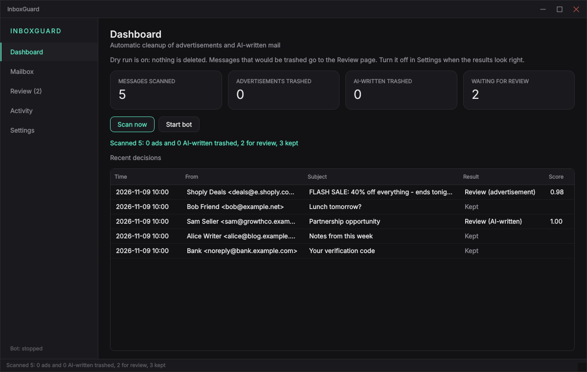
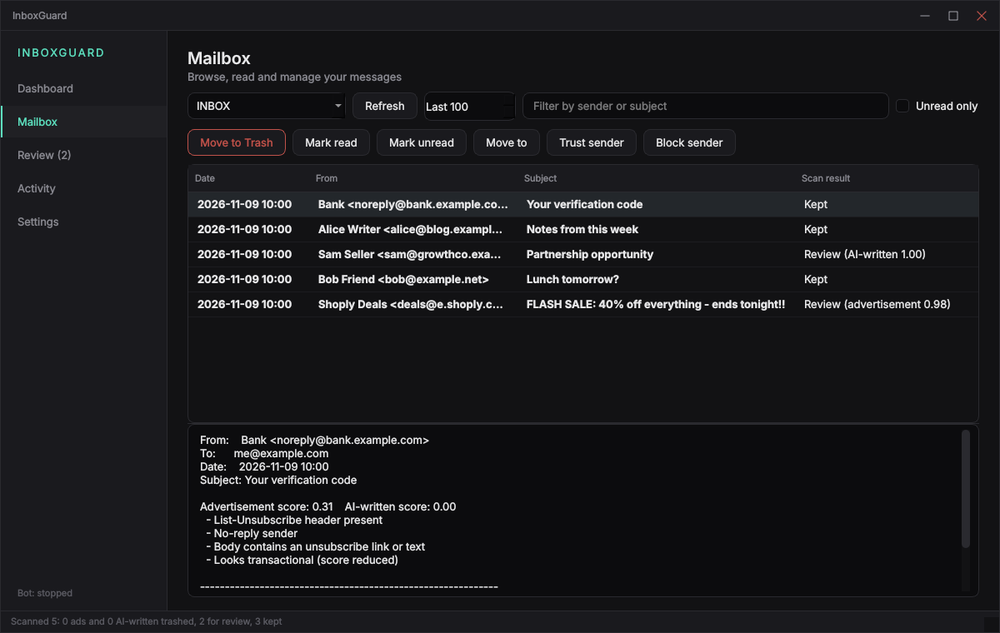
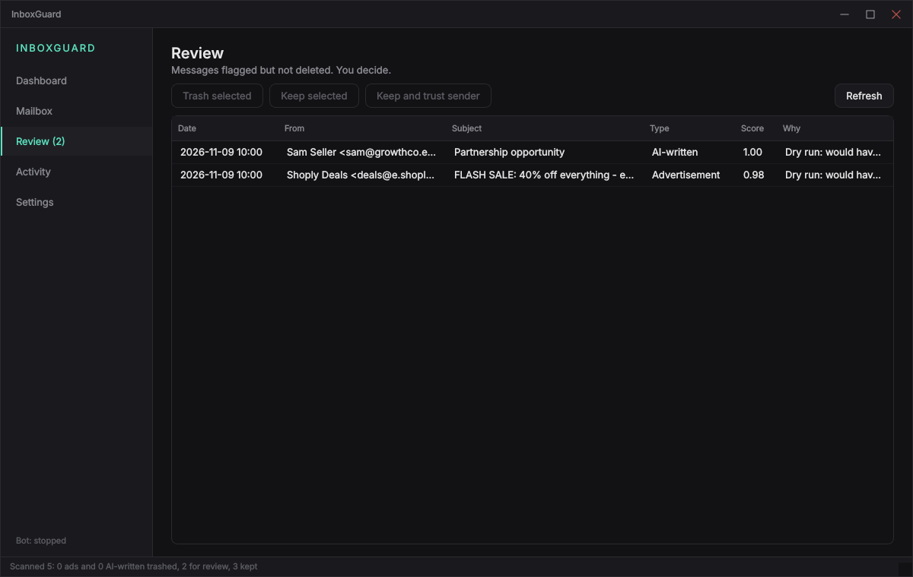
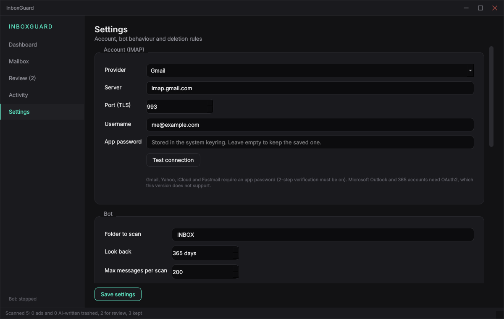

# InboxGuard

A desktop mailbox cleaner for Linux, macOS and Windows that connects to your email account over IMAP, removes advertisements and AI-written messages, and gives you a PyQt6 dashboard to manage the rest of your mail.

It talks to the mail server with Python's standard `imaplib` over TLS, stores your password in the operating system keyring, and moves unwanted mail to Trash instead of erasing it, so every automatic deletion can be undone from the Activity page.

## Features

- **Advertisement detection** — scores `List-Unsubscribe` and `Precedence: bulk` headers, bulk-mail platform headers (Mailchimp, SendGrid, Mailgun, SES and others), marketing-style sender addresses, promotional subject and body wording, tracking pixels and link density
- **AI-written detection** — flags pasted assistant boilerplate and unfilled template placeholders such as `[Your Name]` (hard signals), plus stock phrases, buzzwords, markdown in plain text, em-dash density and uniform sentence length (soft signals)
- **Transactional guard** — verification codes, receipts, password resets and shipping notices have their advertisement score reduced so they are not removed
- **Safe by default** — dry run is on at first start; nothing is deleted until you turn it off, and everything that would have been deleted is listed on the Review page
- **Protected senders** — never touches an address you have written to (read from the Sent folder), anything on your allowlist, and always trashes your blocklist
- **Reversible** — deletions go to the provider's Trash folder and are logged in SQLite; Restore moves a message back to its original folder
- **Full mailbox dashboard** — browse any folder, read messages as plain text (remote content is never loaded), mark read or unread, move between folders, trash, permanently delete from Trash, trust or block a sender
- **Background bot** — scans on a timer without blocking the interface, never marks mail as read, remembers what it has already scanned
- **Headless mode** — `inboxguard --headless` runs the same scanner without a GUI for servers or cron

## Screenshots

Screenshots use generated sample messages, not a real mailbox.

| Dashboard | Mailbox |
|---|---|
|  |  |
| **Review** | **Settings** |
|  |  |

## Requirements

- Linux, macOS or Windows
- Python 3.10 or newer
- A mail account with IMAP enabled that accepts an app password (Gmail, Yahoo, iCloud, Fastmail and most standard IMAP hosts)
- On Linux, the Qt xcb cursor library for X11 sessions:

  ```bash
  # Debian / Ubuntu
  sudo apt install python3-venv libxcb-cursor0

  # Fedora
  sudo dnf install xcb-util-cursor

  # Arch
  sudo pacman -S xcb-util-cursor
  ```

Microsoft Outlook.com and Microsoft 365 accounts require OAuth2, which this version does not implement.

### Getting an app password

Gmail: turn on 2-Step Verification, create an app password in your Google account security settings, and enable IMAP in Gmail settings. Use the 16-character app password in InboxGuard, not your normal password. Other providers have an equivalent "app-specific password" page.

## Installation

### Quick install (recommended)

```bash
git clone https://github.com/black8arch/inboxguard.git
cd inboxguard
./install.sh
```

The installer creates a private virtual environment in `~/.local/share/inboxguard/venv`, installs the package into it, writes a launcher to `~/.local/bin/inboxguard` and adds a desktop entry.

### Manual install

```bash
git clone https://github.com/black8arch/inboxguard.git
cd inboxguard
python3 -m venv venv
source venv/bin/activate
pip install .
inboxguard
```

### Run from source without installing

```bash
git clone https://github.com/black8arch/inboxguard.git
cd inboxguard
pip install -r requirements.txt
python3 -m inboxguard
```

## Usage

First run, step by step:

1. Open **Settings**, pick your provider, enter your address and app password, press **Test connection**, then **Save settings**.
2. Leave **Dry run** on and press **Scan now** on the Dashboard.
3. Open **Review** and check what the bot would have deleted. Use **Keep and trust sender** for false positives.
4. When the results look right, turn off **Dry run** in Settings and press **Start bot**.

| Action | How |
|---|---|
| Scan once | Dashboard, **Scan now** |
| Scan automatically | Dashboard, **Start bot** (interval set in Settings) |
| Cancel a running scan | Dashboard, **Cancel** |
| Read a message | Mailbox, select a row; the preview shows scores and the reasons behind them |
| Trash, mark, move | Mailbox, select rows, use the action buttons |
| Always keep or always trash a sender | Mailbox, **Trust sender** or **Block sender**; or edit the lists in Settings |
| Decide on flagged mail | Review, **Trash selected**, **Keep selected**, **Keep and trust sender** |
| Undo an automatic deletion | Activity, select rows, **Restore selected** |

Headless usage:

```bash
inboxguard --headless --once      # one scan, then exit
inboxguard --headless             # scan forever at the configured interval
INBOXGUARD_PASSWORD='app-password' inboxguard --headless   # when no keyring is available
```

Configure the account once in the GUI, or edit `config.json` in the config directory (`~/.config/inboxguard` on Linux, `~/Library/Application Support/inboxguard` on macOS, `%APPDATA%\inboxguard` on Windows; override with `INBOXGUARD_HOME`).

### How the thresholds work

Each message gets an advertisement score and an AI-written score between 0 and 1. At or above the trash threshold the message is moved to Trash; between the review and trash thresholds it is listed on the Review page; below that it is kept. Defaults: advertisements trash at 0.80, AI-written trash at 0.90.

AI-written detection is heuristic. No tool can prove who wrote a piece of text, and formal human writing, translated text and templates can all score high. For that reason stylistic signals alone are capped below the default 0.90 threshold, so only pasted assistant boilerplate and unfilled placeholders reach automatic deletion. Everything else goes to review. Lower the threshold only if you accept false positives.

## Development

```bash
pip install -r requirements-dev.txt
QT_QPA_PLATFORM=offscreen python3 -m pytest
```

The tests use an in-memory fake IMAP server, so no real account is touched.

## Project structure

```
inboxguard/
├── inboxguard/
│   ├── main.py              # entry point: GUI, or --headless
│   ├── core/                # no Qt imports; testable on its own
│   │   ├── classifier.py    # advertisement and AI-written scoring with reasons
│   │   ├── policy.py        # scores -> keep / review / trash, allow and block lists
│   │   ├── parser.py        # raw RFC 5322 bytes -> ParsedEmail
│   │   ├── mailbox.py       # IMAP client: folders, fetch, move, flags, search
│   │   ├── engine.py        # scan orchestration and progress callbacks
│   │   ├── service.py       # interactive operations used by the dashboard
│   │   ├── store.py         # SQLite: scanned messages and the undo log
│   │   ├── config.py        # settings dataclasses, JSON persistence, paths
│   │   ├── secrets.py       # keyring access for the password
│   │   ├── context.py       # shared runtime context
│   │   └── headless.py      # GUI-less scan loop
│   └── ui/
│       ├── backend.py       # thread pool, scan thread, bot timer, signals
│       ├── main_window.py   # frameless window, sidebar, status strip
│       ├── style.py         # palette and the single stylesheet
│       ├── widgets/         # custom title bar, stat cards, table helpers
│       └── pages/           # dashboard, mailbox, review, activity, settings
├── tests/                   # classifier, core flow against a fake IMAP, UI smoke tests
├── packaging/               # desktop entry template
├── docs/screenshots/
├── install.sh
├── pyproject.toml
└── requirements.txt
```

The `core` package never imports Qt. The UI reaches it only through `ui/backend.py`, which runs every IMAP and database call off the main thread and returns results through signals. Each background task opens its own IMAP connection, because `imaplib` connections are not thread-safe.

## License

MIT — see [LICENSE](LICENSE).
