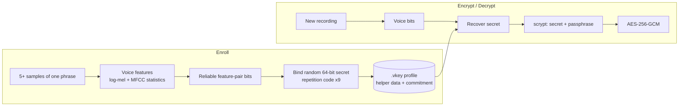

# VoiceCrypt

**Voice-bound file encryption with a desktop GUI.**
Your voice releases a cryptographic secret, a passphrase hardens it, and AES-256-GCM protects the file.

[](https://github.com/YOUR_USER/voicecrypt/actions/workflows/ci.yml)


> **Experimental and unaudited.** A voice is not a secret: it can be recorded or cloned. VoiceCrypt treats it as a *second factor*; the passphrase carries the cryptographic strength. Read the [security model](#security-model) before using it for anything important, and keep backups.

## Features

- **Key bound to your voice** using a fuzzy commitment. The secret is never stored, and a new recording of the same phrase recovers it.
- **Modern crypto:** scrypt (N=2^15, r=8, p=1) key derivation, AES-256-GCM, per-file salt and nonce, authenticated header, encrypted file name.
- **Self-contained `.vcrypt` files:** the voice profile is embedded, so decrypting needs only the file, your voice and your passphrase.
- **Desktop GUI (Tkinter):** Enroll, Encrypt, Decrypt and Verify tabs; microphone recording or WAV import.
- **Stability estimate at enrollment** (leave-one-out) so you know how reliably your voice will unlock the profile.
- **Importable library** (`voicecrypt.core`, no GUI dependency) and a pytest suite.

## How it works



Voice never repeats bit-for-bit, so the key cannot simply be hashed from the audio. Enrollment selects the most stable feature comparisons across your samples and binds a random secret to them with an error-correcting code; later recordings only need to be *close* to recover it. Details: [docs/DESIGN.md](docs/DESIGN.md).

## Installation

Requires Python 3.9+.

```bash
git clone https://github.com/YOUR_USER/voicecrypt.git
cd voicecrypt
python -m venv .venv
source .venv/bin/activate          # Windows: .venv\Scripts\activate
pip install -e .
voicecrypt                         # or: python -m voicecrypt
```

Platform notes:

| Platform | Extra steps |
|---|---|
| Debian / Ubuntu | `sudo apt install python3-tk libportaudio2` |
| macOS (Homebrew Python) | `brew install python-tk` |
| Windows | Nothing extra (PortAudio ships with the `sounddevice` wheel) |

## Usage

1. **Enroll voice**: enter a profile name, record at least 5 samples of the **same phrase** (6-8 words), then *Create voice profile* and save the `.vkey` file. The estimated unlock success is shown; if it is low, re-enroll.
2. **Encrypt**: pick the file and your `.vkey`, record the phrase, set a passphrase, and save the `.vcrypt` file.
3. **Decrypt**: pick the `.vcrypt` file, record the phrase, enter the passphrase, and save the result.
4. **Verify voice**: test a new recording against a profile without touching any file.

Tips for reliable results: same phrase every time, same microphone, quiet room, constant distance, natural volume and pace, and avoid clipping.

## Library usage

```python
import numpy as np
from voicecrypt import core

# Enrollment
feats = [core.extract_features(core.load_wav(f"enroll_{i}.wav")) for i in range(5)]
profile = core.create_profile(np.vstack(feats), name="alice")

# Encrypt
attempt = core.extract_features(core.load_wav("attempt.wav"))
secret, mismatch = core.recover_secret(profile, attempt)
if secret is None:
    raise SystemExit("voice not recognised")
core.encrypt_file("notes.txt", "notes.txt.vcrypt", profile, secret, "a long passphrase")

# Decrypt
meta, aad, nonce, ct = core.read_container("notes.txt.vcrypt")
secret, _ = core.recover_secret(meta["profile"], attempt)
name, data = core.decrypt_payload(meta, aad, nonce, ct, secret, "a long passphrase")
```

## Security model

What it provides: confidentiality and integrity of the file (and its name) under a key that needs both a matching voice and the passphrase; no stored secret; tamper detection.

What it does not provide:

- **No protection from voice recordings or cloning.** No liveness detection.
- **Weak speaker discrimination.** The model uses spectral statistics, not neural embeddings; similar voices may pass.
- **Offline voice guessing is possible** without the passphrase (the commitment verifies the secret); scrypt and the passphrase then do the work.
- **No recovery.** Lose the passphrase or be unable to reproduce your voice, and the data is gone.

Full list and reporting instructions: [SECURITY.md](SECURITY.md).

## Configuration

Constants at the top of `voicecrypt/core.py`:

| Constant | Default | Effect |
|---|---|---|
| `SECRET_BITS` | 64 | Size of the secret bound to the voice |
| `REPEAT` | 9 | Repetition-code length; higher tolerates noisier voices |
| `FEATURE_USE_CAP` | 20 | Max reuse of one feature across bit pairs |
| `MIN_ENROLL` | 5 | Minimum enrollment samples |
| `SCRYPT_N/R/P` | 2^15 / 8 / 1 | Key-derivation cost |
| `MAX_FILE` | 512 MB | Whole-file limit (files are processed in memory) |

Changing any of these (or the feature constants) alters the format. Existing profiles and files will not decrypt; see [CONTRIBUTING.md](CONTRIBUTING.md).

## Development

```bash
pip install -e ".[dev]"
pytest -q
```

```
voicecrypt/
  core.py        features, fuzzy commitment, key derivation, container format
  gui.py         Tkinter application
  __main__.py    python -m voicecrypt
tests/           pytest suite (synthetic voices, no mic or GUI needed)
docs/DESIGN.md   algorithms and file formats
```

The tests use synthetic voices. They check the full encrypt/decrypt cycle, rejection of a different voice, wrong passphrases and tampering, but they cannot measure how stable real human voices are; test with your own microphone using the Verify tab.

## Roadmap

- Liveness / anti-replay checks
- Stronger error-correcting code (BCH or Reed-Solomon) and speaker embeddings
- KDF parameters and feature version stored in the header
- Streaming encryption for large files
- Command-line interface and packaged releases

## Contributing

See [CONTRIBUTING.md](CONTRIBUTING.md). Please report security issues privately as described in [SECURITY.md](SECURITY.md).

## License

[MIT](LICENSE)
